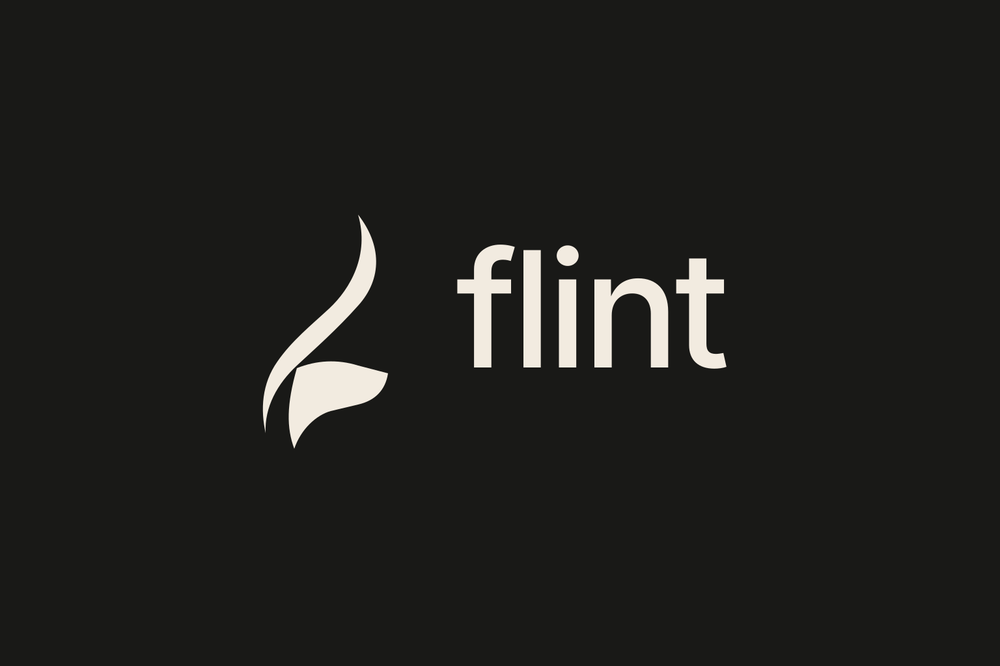

# Flint

A general-purpose programming language with Python-like syntax, being built to also
handle system-level work (FFI, DLL import/export) through an opt-in system mode.
Flint source files use the `.fl` extension.

## Current status

A working language written in Rust with two execution engines: a tree-walking
interpreter and a bytecode VM (compiled from the AST). Programs that use classes
or `import` run on the tree-walking interpreter; everything else runs on the
bytecode VM. The language core is functional:

- variables (`let x = 1`, assignment `x = 2`)
- arithmetic (`+ - * / %`), comparison, and logic (`and`, `or`, `not`)
- conditionals (`if` / `elif` / `else`), loops (`while`, `for ... in`)
- functions with closures and recursion (`fn ... return`)
- classes with methods, constructors (`init`), and `this`
- lists, indexing (incl. negative), element assignment, string concatenation/repetition
- dictionaries/maps: `{key: value}` literals, indexing, assignment, iteration, `keys`, `has`
- modules via `import "file.fl"`
- FFI to C libraries via `ffi_load` / `ffi_call` (cross-platform through `libloading`)
- native memory access: `ffi_alloc`, `ffi_free`, `ffi_read_*`, `ffi_write_*` for structs/pointers
- string methods: `upper`, `lower`, `strip`, `split`, `replace`, `len`
- list methods: `append`, `pop`, `join`, `len`
- a growing standard library: `print`, `len`, `str`, `int`, `float`, `range`, `append`, `pop`, `input`, `keys`, `has`
- negative indexing (`list[-1]`)
- an interactive REPL

## Build and run

```sh
cargo build --release
./target/release/flint              # REPL
./target/release/flint examples/demo.fl   # run a file (from the repo root)
```

## Example

```python
fn fib(n) {
    if n < 2 { return n }
    return fib(n - 1) + fib(n - 2)
}
print("fib(10) =", fib(10))
```

## Layout

| Path | Purpose |
|------|---------|
| `src/main.rs` | CLI: REPL + file runner |
| `src/lib.rs` | Crate root; re-exports every module |
| `src/syntax/token.rs` | Token types |
| `src/syntax/lexer.rs` | Source text -> tokens |
| `src/syntax/ast.rs` | Abstract syntax tree |
| `src/syntax/parser.rs` | Tokens -> AST |
| `src/runtime/eval.rs` | Tree-walking evaluator and native registration |
| `src/runtime/value.rs` | Runtime values |
| `src/runtime/env.rs` | Lexical scoping environment |
| `src/runtime/error.rs` | Error types |
| `src/runtime/ffi.rs` | FFI natives: library loading, calls, native memory |
| `src/bytecode/chunk.rs` | Opcodes and bytecode chunks |
| `src/bytecode/compiler.rs` | AST -> bytecode compiler |
| `src/bytecode/vm.rs` | Bytecode VM |
| `examples/` | Sample `.fl` programs and the Rust source for the FFI demo library |
| `assets/` | Logo files |

## FFI struct demo

```sh
rustc --edition 2021 --crate-type=cdylib -o examples/libpoint.so examples/point.rs
./target/release/flint examples/ffi_struct.fl
```

## Roadmap

- [x] Interpreter core (lexer, parser, evaluator, REPL)
- [x] Classes with methods, constructors, and `this`
- [x] Modules / `import`
- [x] Bytecode VM (compiler + VM) with fallback to tree-walking eval
- [x] FFI / dynamic library loading (`ffi_load`, `ffi_call`)
- [ ] Error handling (exceptions) with line numbers
- [ ] Bytecode VM
- [ ] LLVM backend -> native executables
- [ ] FFI + DLL import/export (system mode)
